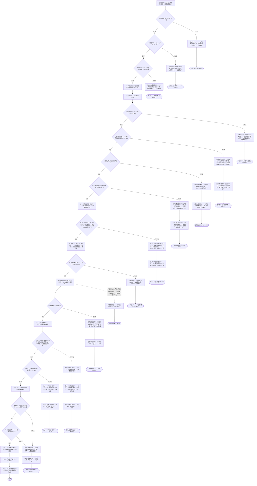
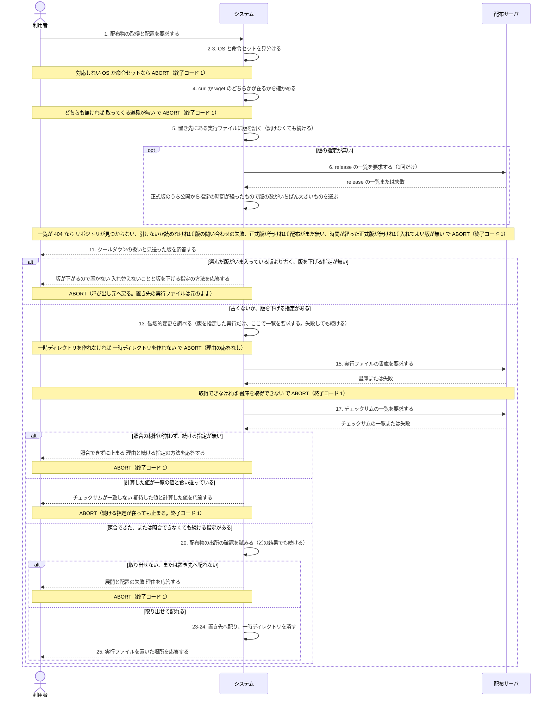

# ユースケース: 配布物を取って置く

> **ネットワークインストーラーのうち、実行ファイルを配布サーバから取って置き先へ置く段だけを書いた記述である。**
> `continuoを入れる` が `INCLUDE USE CASE` で引く。足りない道具を扱う段（`前提の道具を調べて入れる`）とは互いに影響しないので、分けて書く。
>
> **この記述の代替フローは、`版が下がるので置かない` を除いて、どれもインストーラーをその場で終える。**
> `版が下がるので置かない` だけは、実行ファイルを入れ替えずに呼び出し元へ戻る（インストーラーは終わらない）。
> 呼び出し元は、置き終えたか、版が下がるので元の実行ファイルを残したかを検証して、どちらでもなければ残りの段を行わない。

## 根拠資料

- `docs/plans/continuo_design.md` の「3-36. 入れ方は、ネットワークインストーラーの1行にする」（破壊的変更のある版へ上げるときの警告を含む）
- `docs/plans/continuo_design.md` の「3-32b. Windows ネイティブは対応しない」
- `install.sh` の `main`（呼び出し元。`detect_platform` から `install_binary` までの並び）
- `install.sh` の `detect_platform` / `resolve_version` / `select_release` / `cooldown_label` / `install_line` / `fetch` / `download`
- `install.sh` の `install_binary` / `verify_checksum` / `checksum_failed` / `verify_provenance`
- `install.sh` の `detect_installed_version` / `collect_breaking` / `breaking_lines` / `report_kept`

## 取ってくる道具が無いとき

段4 は `install.sh` の `main` の1行である。OS と命令セットを見分けたあと、入れる版を決める前に、`curl` か `wget` のどちらかが在るかを確かめる。
どちらも無ければ、`エラー: curl も wget もありません。どちらかを入れてください` を標準エラーへ出して、終了コード 1 で終わる（代替フロー `取ってくる道具が無い`）。
版を指定した実行でも、指定しない実行でも、同じ場所で止まる。配布サーバへは1度も繋がない。

`fetch` と `download` にも同じ文の `die` が在るが、段4 を通ったあとなので、そこへは届かない。

## いま入っている版を訊く段は、どの結果でも止めない

段5 は `install.sh` の `detect_installed_version` である。**入れる版を決める前に訊く。**
決めた版がいま入っている版より古くなるかを、段11 の応答の中で言うためである。
置き換えたあとでは何版から上げたのかを誰も知らないので、書庫を取るより前でもある。

**比べられる版を取れない場合を並べる。**どれも次の段は同じで、段12 の比べ（下がるか）と段13 の破壊的変更の調べが「比べる相手がいない」として何もしないだけである。

| 場合 | 何が起きるか |
| --- | --- |
| 置き先に実行ファイルが無い（新規の導入） | 版を取らない |
| 置き先の `continuo` が symlink である | 版を取らない（リンク先を走らせない） |
| 置き先の `continuo` が通常のファイルでないか、実行の権限が無い | 版を取らない |
| `version` の呼び出しが失敗するか、何も出さない（`timeout` が在る環境では5秒で打ち切る） | 版を取らない |
| 名乗った版が `vN.N.N` の形でない（`dev` など） | 版は取るが、比べない |

## 入れる版の決め方

`install.sh` の `resolve_version` と `select_release` が決める。**どちらの行でも、決まったあとに通る段は同じである。**だから rucm ブロックでは段6 の1つにしてある。

| 状況 | どう決めるか |
| --- | --- |
| `--version` を指定している | 指定した版を使う。**クールダウンを当てない。**release の一覧から版を選ばない。段7〜10 の検証は、問い合わせていないので真になる。段12 も真になる（名指しした版は、いま入っている版より古くても入れる） |
| 指定していない | release の一覧（`releases?per_page=100`）を1回引く。正式版（`draft` でも `prerelease` でもないもの）のうち、公開（`published_at`）から `--cooldown-hours` の時間（既定 168）以上経ったもので、版の数がいちばん大きいものを選ぶ。`--cooldown-hours 0` なら時間で絞らない |

**版の数で選ぶ。公開の新しさでは選ばない。**古い系列へ修正版を出しても、新しい系列を選ぶ。

版を指定しない実行が止まる場合は、次のとおりである。**`--version` の実行は、ここではどれにも当たらない。**

| 何が起きたか | どこで止まるか |
| --- | --- |
| 一覧の応答が 404（一覧の API は release が無くても 200 の `[]` を返すので、リポジトリが見つからない） | `リポジトリが見つからない` |
| 一覧の応答が 200 でも 404 でもない（レートリミット・繋がらない） | `版の問い合わせの失敗` |
| 一覧から版を選ぶ処理（`select_release` の awk）が落ちた | `版の問い合わせの失敗`（理由と、版を指定して実行し直す案内を出す。問い合わせ先は出さない） |
| 正式版が1つも無い（一覧が `[]`、または `prerelease` と `draft` だけ） | `配布がまだ無い`（クールダウンを 0 にしても入らないので、0 を勧めない） |
| 正式版は在るが、公開から指定の時間が経ったものが無い | `入れてよい版が無い` |

wget しか無い実行では状態を取れないので、応答が空なら `版の問い合わせの失敗` として扱う（404 も見分けない）。
**`date -u` が失敗した実行は、理由の1行（`エラー: いまの時刻を読めません…`）だけを標準エラーへ出して終了コード 1 で止まる。**案内を出さないので、rucm ブロックの代替フローには書いていない。

## 段11 の応答（「クールダウン:」の数行）

`resolve_version` が版を決めた直後に、標準出力へ出す。

| 状況 | 出る行 |
| --- | --- |
| `--version` を指定している | 「クールダウン: --version で版を指定されたので、使いません。」の1行だけ |
| `--cooldown-hours 0` | 見出しが「クールダウン: 0 時間を指定されたので、公開からの時間で絞りません。」になる |
| それ以外 | 見出しは「クールダウン: 公開から H 時間経った版だけを入れます。」（H が 24 の倍数なら「（N日）」を添える） |
| 選んだ版より版の数が大きく、時間が経っていない版が在る | 「見送った版:」を大きい順に5行まで。残りは「ほか N 件」の1行。続けて、クールダウンを 0 にする1行と、時間の変え方 |
| 見送った版が無く、時間が 0 でない | 時間の変え方と、0 にすると公開直後の版も入ることの1行 |
| 選んだ版がいま入っている版より古く、`--force` が在る | 「入れる版:」に続けて、`--force` が付いているので版を下げる、の1行 |
| 選んだ版がいま入っている版より古く、`--force` が無い | 段12 が偽になり、`版が下がるので置かない` へ行く（ラベルは「選んだ版:」になる） |

**案内の1行は、いまの実行で効いている取得元（`--repo`）・置き先（`--dir` か環境変数 `CONTINUO_INSTALL_DIR`）・既定と違う時間を足して組み立てる**（`install_line`）。貼った結果が表示と同じになるようにするためである。

## 版が下がるときは、置かずに呼び出し元へ戻る

段12 が偽になるのは、版を指定しない実行で、選んだ版がいま入っている版（`vN.N.N` の形のもの）より小さく、`--force` が無いときである。
**`--cooldown-hours 0` の実行にも当てる。**

| いま入っている版 | 代替フロー `版が下がるので置かない` の段1 で出る行 |
| --- | --- |
| 見送った版のどれかが、いま入っている版以上である（クールダウンのせいで下がる） | 「クールダウンを当てると A → B へ版が下がるので、入れ替えません。」 |
| 一覧の正式版のどれより大きい（取り下げられた版か prerelease） | 「配布している正式版のどれより新しい版です（…）。入れ替えません。」 |

代替フローの段2 では、見送った版にいま入っている版より大きいものが在るときだけ、クールダウンを 0 にする1行も出す。そのあとに `--force` を付けた1行を出す。

**入れ替えないことは、インストーラーの失敗ではない。**このあと呼び出し元は、前提の道具を調べて、PATH と次にやることを案内し、最後にもう1度「実行ファイルは入れ替えていません」を出して終了コード 0 で終わる（`continuoを入れる` の段10、`install.sh` の `report_kept`）。
いま入っている版と同じ版を選んだときは、下がらないので、これまでどおり入れ直す。

## 破壊的変更を調べる段は、どの結果でも止めない

段13 は `collect_breaking` である。**何も見つからない場合を並べる。**
どれも次の段は同じで、違いは `continuoを入れる` の最後の案内に行が出るかどうかだけである。

| 場合 |
| --- |
| 段5 で比べられる版を取れなかった（上の表の5つ） |
| 入れる版が `vN.N.N` の形でない |
| release の一覧を引けない（**`--version` の実行だけ**。この段で初めて一覧を引く。版を指定しない実行は、段6 で引いた一覧を使い、引けなければ段7・8 で止まっている） |
| 印を読み出す処理が落ちる |
| 上げる範囲に印が無い（`--force` で下げる場合と、`-rc1` などの付いた版から同じ数字の正式版へ上げる場合を含む） |

## チェックサムを照合できないとき

**`--insecure-no-checksum` は、照合を省く指定ではない。**照合は、指定が在っても行う。
指定が効くのは、照合できなかったときだけである（`install.sh` の `checksum_failed`）。

| 状況 | 指定が無い | 指定が在る |
| --- | --- | --- |
| `shasum` も `sha256sum` も無い | 止まる（`照合できずに止まる`） | 警告を標準エラーへ出して続ける |
| `checksums.txt` を取得できない | 止まる（`照合できずに止まる`） | 警告を標準エラーへ出して続ける |
| `checksums.txt` に書庫の行が無い | 止まる（`照合できずに止まる`） | 警告を標準エラーへ出して続ける |
| 計算した値が一覧の値と合わない | 止まる（`チェックサムが一致しない`） | **止まる**（`チェックサムが一致しない`） |

**警告して続ける実行は、照合したことを応答しない。**そのあと通る段は、照合できた実行と同じである。

## 配布物の出所の確認は、どの結果でも止めない

段20 は `install.sh` の `verify_provenance` である。結果を伝えるだけで、導入を止めない。

| 状況 | 何が出るか |
| --- | --- |
| 取得先が既定でない | 何も出さない。確かめない |
| `gh` が無い | 確かめなかったことと、あとで確かめるコマンド |
| `gh attestation verify` が成功する | 確かめたこと |
| `gh attestation verify` が失敗する | 確かめられなかったことと、考えられる理由と、自分で確かめるコマンド |

## 置き先へ移す操作は、不可分とは限らない

`install.sh` の `install_binary` は、一時ディレクトリの `continuo` を `mv` で置き先へ移す。一時ディレクトリは `mktemp -d` の既定の場所に作るので、
**置き先と別のファイルシステムに在ることがある。**その場合の `mv` は、写してから消す動きになる。
**途中で失敗したときに、前の版が無傷で残ることを守る行は `install.sh` に無い。**代替フロー `展開と配置の失敗` の事後条件は、そのとおりに書いてある。

## 一時ディレクトリを作れないとき

`install_binary` の最初の `mktemp -d` は、`trap` を張る前に走る。`set -eu` の下なので、失敗するとスクリプトはその場で終わる。
**`die` を通らないので、`エラー:` で始まる行も案内も出ない。**出るのは `mktemp` 自身の文だけである。終了コードは 0 でない（値は測っていない）。

## RUCM

```rucm
USE CASE NAME: 配布物を取って置く
BRIEF DESCRIPTION: システムは公開から指定の時間が経った版を入れる版に選ぶ。システムは利用環境に合う実行ファイルの書庫を配布サーバから取る。システムはチェックサムを照合する。システムは実行ファイルを置き先へ配る。システムは取れない場合と照合できない場合に、実行ファイルを置かずに止まる。システムは版が下がる場合に、実行ファイルを入れ替えずに呼び出し元へ戻る。
PRECONDITION: 利用者はネットワークインストーラーを実行している。システムは引数の解釈と取得先の確認を済ませている。
PRIMARY ACTOR: 利用者
SECONDARY ACTORS: 配布サーバ
DEPENDENCY: なし
GENERALIZATION: なし

BASIC FLOW:
1. 利用者はシステムに配布物の取得と配置を要求する。
2. システムは VALIDATES THAT 利用者の OS が対応している。
3. システムは VALIDATES THAT 利用者の命令セットが対応している。
4. システムは VALIDATES THAT 利用者の手元に curl か wget のどちらかがある。
5. システムは置き先にある実行ファイルに版を訊く。
6. システムは入れる版を決める。
7. システムは VALIDATES THAT 取得元のリポジトリが見つかっている。
8. システムは VALIDATES THAT 版の問い合わせと一覧の読み取りが失敗していない。
9. システムは VALIDATES THAT 配布している正式版がある。
10. システムは VALIDATES THAT 公開から指定の時間が経った正式版がある。
11. システムは利用者にクールダウンの扱いと見送った版を応答する。
12. システムは VALIDATES THAT 入れる版が置き先にある実行ファイルの版より古くないか、利用者が版を下げる指定をしている。
13. システムは置き先にある実行ファイルの版から入れる版までの破壊的変更を調べる。
14. システムは VALIDATES THAT 書庫を置く一時ディレクトリを作れている。
15. システムは配布サーバに実行ファイルの書庫を要求する。
16. システムは VALIDATES THAT 書庫を取得できている。
17. システムは書庫のチェックサムの照合を試みる。
18. システムは VALIDATES THAT 照合の材料が揃わない実行では利用者が照合できなくても続ける指定をしている。
19. システムは VALIDATES THAT 計算した値が一覧の値と食い違っていない。
20. システムは配布物の出所の確認を試みる。
21. システムは VALIDATES THAT 書庫から通常のファイルの continuo を取り出せる。
22. システムは VALIDATES THAT 取り出した continuo を置き先へ配れる。
23. システムは実行の権限を付けた continuo を置き先へ配る。
24. システムは一時ディレクトリを消す。
25. システムは利用者に実行ファイルを置いた場所を応答する。
POSTCONDITION: 置き先に入れる版の continuo の実行ファイルがある。実行ファイルに実行の権限が付いている。一時ディレクトリは残っていない。版を指定しない実行では、入れる版は公開から指定の時間が経った正式版のうち版の数がいちばん大きいものである。クールダウンの扱いは標準出力に出ている。照合の材料が揃った実行では、照合したことが標準出力に出ている。照合の材料が揃わない実行では、照合できない理由が標準エラーに出ている。置いた場所は標準出力に出ている。システムは終了していない。

SPECIFIC ALTERNATIVE FLOW 対応しないOS:
RFS BASIC FLOW 2
1. システムは利用者に OS が対応していないことを応答する。
2. ABORT
POSTCONDITION: システムは置き先に実行ファイルを置いていない。システムは配布サーバに何も要求していない。OS が Windows 系である実行では、利用者は WSL2 の中で実行する案内を読める。残りの OS の実行では、利用者は対応している OS の名前を読める。理由は標準エラーに出ている。終了コード 1 が返っている。

SPECIFIC ALTERNATIVE FLOW 対応しない命令セット:
RFS BASIC FLOW 3
1. システムは利用者に対応している命令セットを応答する。
2. ABORT
POSTCONDITION: システムは置き先に実行ファイルを置いていない。システムは配布サーバに何も要求していない。理由は標準エラーに出ている。終了コード 1 が返っている。

SPECIFIC ALTERNATIVE FLOW 取ってくる道具が無い:
RFS BASIC FLOW 4
1. システムは利用者に curl も wget も無いことを応答する。
2. ABORT
POSTCONDITION: システムは置き先に実行ファイルを置いていない。システムは配布サーバに何も要求していない。システムはまだ配布していないことを応答していない。版を指定した実行でも、システムは同じ理由で止まっている。理由は標準エラーに出ている。終了コード 1 が返っている。

SPECIFIC ALTERNATIVE FLOW リポジトリが見つからない:
RFS BASIC FLOW 7
1. システムは利用者に一覧の場所と取得元を確かめる案内を応答する。
2. ABORT
POSTCONDITION: システムは置き先に実行ファイルを置いていない。システムは配布サーバに書庫を要求していない。システムはまだ配布していないことを応答していない。案内は標準出力に出ている。理由は標準エラーに出ている。終了コード 1 が返っている。

SPECIFIC ALTERNATIVE FLOW 版の問い合わせの失敗:
RFS BASIC FLOW 8
1. システムは利用者に問い合わせられない理由か一覧を読み取れない理由を応答する。
2. システムは利用者に版を指定して実行し直す案内を応答する。
3. ABORT
POSTCONDITION: システムは置き先に実行ファイルを置いていない。システムは配布サーバに書庫を要求していない。システムはまだ配布していないことを応答していない。案内は標準出力に出ている。止まった理由は標準エラーに出ている。終了コード 1 が返っている。

SPECIFIC ALTERNATIVE FLOW 配布がまだ無い:
RFS BASIC FLOW 9
1. システムは利用者にまだ配布していないことを応答する。
2. システムは利用者にソースから作る手順を応答する。
3. ABORT
POSTCONDITION: システムは置き先に実行ファイルを置いていない。利用者はソースから作る手順を読める。システムはクールダウンを 0 にする案内を応答していない。応答は全部が標準出力に出ている。標準エラーには何も出ていない。終了コード 1 が返っている。

SPECIFIC ALTERNATIVE FLOW 入れてよい版が無い:
RFS BASIC FLOW 10
1. システムは利用者にいちばん早く入れられる版と入れられるまでの時間を応答する。
2. システムは利用者にクールダウンを 0 にして実行し直す案内を応答する。
3. ABORT
POSTCONDITION: システムは置き先に実行ファイルを置いていない。システムは配布サーバに書庫を要求していない。案内は標準出力に出ている。理由は標準エラーに出ている。終了コード 1 が返っている。

SPECIFIC ALTERNATIVE FLOW 版が下がるので置かない:
RFS BASIC FLOW 12
1. システムは利用者に版が下がるので実行ファイルを入れ替えないことを応答する。
2. システムは利用者に版を下げる指定の方法を応答する。
3. ABORT
POSTCONDITION: 置き先の実行ファイルは元のままである。システムは配布サーバに書庫を要求していない。システムは破壊的変更を調べていない。見送った版に置き先の実行ファイルの版より大きいものがある実行では、利用者はクールダウンを 0 にする案内も読める。案内は標準出力に出ている。システムは終了していない。

SPECIFIC ALTERNATIVE FLOW 一時ディレクトリを作れない:
RFS BASIC FLOW 14
1. システムは残りの段を行わずに終了する。
2. ABORT
POSTCONDITION: システムは置き先に実行ファイルを置いていない。システムは配布サーバに書庫を要求していない。システムは理由も案内も応答していない。システムの応答にエラーで始まる行は無い。一時ディレクトリを作るコマンドが出した文だけが標準エラーに出ている。0 でない終了コードが返っている。

SPECIFIC ALTERNATIVE FLOW 書庫を取得できない:
RFS BASIC FLOW 16
1. システムは利用者に入れる版に書庫が無いことと配布している一覧の場所を応答する。
2. システムは一時ディレクトリを消す。
3. ABORT
POSTCONDITION: システムは置き先に実行ファイルを置いていない。一時ディレクトリは残っていない。案内は標準出力に出ている。取得に失敗した場所は標準エラーに出ている。終了コード 1 が返っている。

SPECIFIC ALTERNATIVE FLOW 照合できずに止まる:
RFS BASIC FLOW 18
1. システムは利用者に照合できない理由を応答する。
2. システムは利用者に照合できなくても続ける指定の方法を応答する。
3. システムは一時ディレクトリを消す。
4. ABORT
POSTCONDITION: システムは書庫を展開していない。システムは置き先に実行ファイルを置いていない。一時ディレクトリは残っていない。案内は標準出力に出ている。止まった理由は標準エラーに出ている。終了コード 1 が返っている。

SPECIFIC ALTERNATIVE FLOW チェックサムが一致しない:
RFS BASIC FLOW 19
1. システムは利用者に期待した値と計算した値を応答する。
2. システムは一時ディレクトリを消す。
3. ABORT
POSTCONDITION: システムは書庫を展開していない。システムは置き先に実行ファイルを置いていない。一時ディレクトリは残っていない。照合できなくても続ける指定がある実行でも、システムは止まっている。利用者は取得をやり直す案内を読める。理由は標準エラーに出ている。終了コード 1 が返っている。

BOUNDED ALTERNATIVE FLOW 展開と配置の失敗:
RFS BASIC FLOW 21,22
1. システムは利用者に展開か配置に失敗した理由を応答する。
2. システムは一時ディレクトリを消す。
3. ABORT
POSTCONDITION: システムは入れる版の実行ファイルを置き終えていない。置き先へ移す操作より前に失敗した実行では、システムは置き先の実行ファイルに触っていない。置き先へ移す操作が失敗した実行では、置き先に前の版の実行ファイルが無傷で残っていることを、システムは保証していない。一時ディレクトリは残っていない。理由は標準エラーに出ている。終了コード 1 が返っている。

GLOBAL ALTERNATIVE FLOW 取得中の中断:
BRANCH FROM BASIC FLOW 15
WHEN システムが一時ディレクトリを作ってから実行ファイルを置くまでのあいだに中断のシグナルを受け取る場合
1. システムは一時ディレクトリを消す。
2. ABORT
POSTCONDITION: 一時ディレクトリは残っていない。受け取ったシグナルが SIGINT である実行では、終了コード 130 が返っている。受け取ったシグナルが SIGTERM か SIGHUP である実行では、終了コード 143 が返っている。システムは中断について何も応答していない。
```

## フローチャート



## シーケンス図


