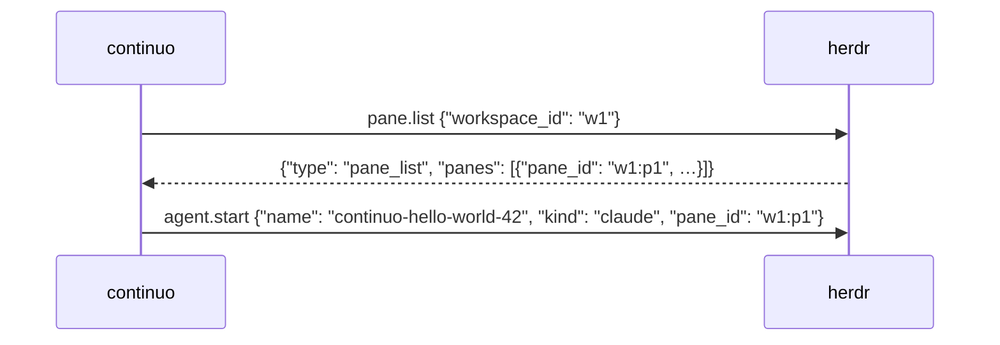

- 計画を書く前に、そもそも対応するかを3つの問いで確かめます。
- 計画のコメントは、1行目に `<!-- continuo:agent -->`、2行目に `<!-- continuo:plan -->` を置き、ファイルへ書いてから `--body-file` で渡します。
- 計画を書いたら、そのまま実装に入りません。報告のコメントで確認を訊き、`CONTINUO-STATUS: blocked` で止まります（「finishing-run」の「runの終了を宣言する」）。Status の変更だけは了承とみなしません。
- **issue をあなたの判断だけで閉じません。**

## 計画を書き、レビューを受ける

計画を書く前に、次の3つをこの順で問います。

    1. そもそも対応するか。「対応しません」と文書に書くだけで済まないか
    2. 利用者が自分で回避できるか。できるなら、その手順を文書に書くだけで足りないか
    3. その仕組みを持つべきか。持つと何ファイル触るか

- 3つ目で触るファイルが十数個に膨らんだら、1つ目へ戻ります。計画を何版も重ねたあとで「対応しない」となると、それまでの計画が全部無駄になります。
- 「対応しない」と決めたら、理由を「finishing-run」の「runの終了を宣言する」の報告のコメント（`### 詳細`）に書いて `CONTINUO-STATUS: blocked` を出します。理由のためだけに別のコメントを立てません（「writing-comments-for-humans」の「人間へ質問・報告するコメントの書き方」）。
- **issue をあなたの判断だけで閉じません。draft の pull request が残っていても閉じず、その URL を報告に書きます。**閉じるかは人間が決めます。

そのうえで、次の4段をこの順に行います（段3と段4は「running-review-loop」にあります）。計画を書いたら、そのまま実装に入りません（実装してからの手戻りは、計画を直すより高くつきます）。

### 段1. 計画を書く

まず、「starting-run」の「関連する記録を読む」で読んだ記録に、同じことが既に決まっていないかを、触るファイルの名前・関数名・エラーの文面で探します。探さずに書くと、記録の決定と逆のことを書きます。

計画に書くこと。

    - 何が原因か（根拠つき。ファイル名と行番号）
    - どのファイルをどう直すか
    - 決まっていないこと（あれば、何が分かれば決まるかも）
    - 実装する内容の概要の図

図は mermaid の `flowchart` か `sequenceDiagram` で書きます（GitHub は issue のコメントの mermaid を図として表示します）。描くのは、変えたあとに何がどの順で起きるかです。変えるファイルの一覧は図にせず、上の箇条のとおり別に書きます。



計画は issue のコメントに、**ファイルへ書いてから `--body-file` で渡します。**`--body "…"` で渡すと、計画に混ざる backtick とドルの記号が二重引用符の中で実行されます。

```bash
F=$(mktemp)
cat > "$F" <<'PLAN'
<!-- continuo:agent -->
<!-- continuo:plan -->
# 計画

## <一言で中身が想像できる節の題名>

ここに「writing-comments-for-humans」の8つの見出しを置く
（症状は「### 何が問題なのか」へ、原因（ファイル名と行番号つき）と
 どのファイルをどう直すかと、決まっていないことと図は「### 詳細」へ書く）
PLAN
gh issue comment <issue の URL> --body-file "$F"
```

- 見本は囲みの中身をそのまま使います。`PLAN` の行は行頭に置きます（字下げすると、そこで終わりと読まれません）。
- **本文の中に、終わりの語（`PLAN` など、`<<'…'` の中の語）だけの行を作りません。**入るとそこで本文が切れ、後ろの行がシェルのコマンドとして実行されます。見本を囲みごと引用すると入るので、そのときは終わりの語を変えます（例: `PLAN` を `PLAN2` に）。
- **2行目の `<!-- continuo:plan -->` を落としません。**落とすと continuo が「この run は成果を書いた」と誤って数え、turn が途中で終わったときに何をしたかを書かせ直す経路が飛びます。
- `<!-- design-review-result -->` は付けません。その目印は判断票だけに付けます。
- `mktemp` で作ったファイルは、消さなくてかまいません。
- 2回目以降の試行では、`<!-- continuo:plan -->` が付いた自分のコメントがあれば書き足さず、続きから始めます（同じ計画が並ぶと issue が読めなくなります）。人間の直しや回答を受けて見直した計画は、新しい計画のコメントに書きます。計画のコメントが複数あれば、いちばん新しいものが正です。
- 節の書き方は「writing-comments-for-humans」の「人間へ質問・報告するコメントの書き方」にあります（判断票も同じ）。

### 段2. 人間の確認を受ける

「finishing-run」の「runの終了を宣言する」の報告のコメント（印は `<!-- continuo:agent -->` の1行だけ）を新しく1件書いて、「この計画で設計レビューへ進めてよいか。了承なら、そうコメントしてから Status を `Ready` へ戻してください」と訊き、応答の最後に `CONTINUO-STATUS: blocked` を書いて止まります。

**計画のコメントの中で訊きません。**continuo は計画のコメントを、この run の成果として数えません。

| 次に見えたもの | すること |
| --- | --- |
| 自分の問いより後に、人間のはっきりした了承 | 「running-review-loop」の「段3. 設計レビューを回す」へ進みます |
| Status の変更だけ | **了承とみなしません** |
| 直しの求め | 計画を直して新しい計画のコメントに書き、もう一度訊いて止まります |

<!-- continuo-skill-end: writing-plan CONTINUO_PLUGIN_HASH -->
